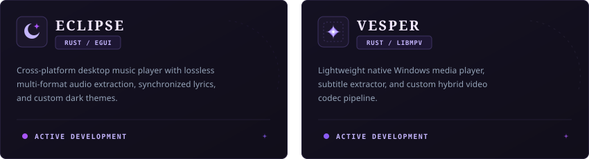
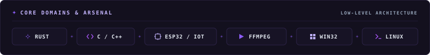

  

  

  

  <a href="https://github.com/Caly-sys/Eclipse"><b>[ ECLIPSE REPOSITORY ]</b></a>
  &nbsp;&nbsp;&nbsp;&nbsp;&nbsp;&nbsp;
  <a href="https://github.com/Caly-sys/vesper"><b>[ VESPER REPOSITORY ]</b></a>

 

  

 

 

  

